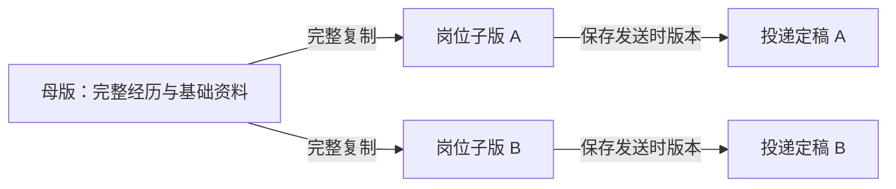
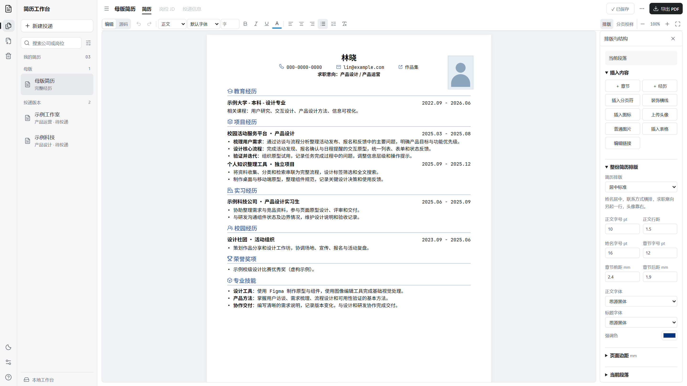
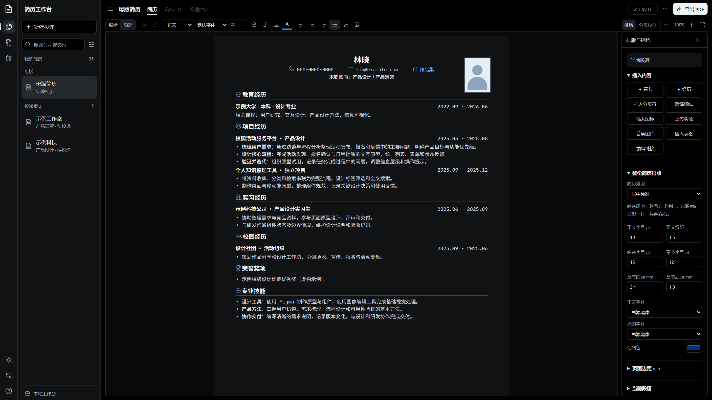

# LapisCV WebUI · 简历工作台

支持可视化编辑与 AI Agent 协作的本地中文简历工作台。以 Markdown 文件保存内容，通过母版、独立岗位子版和投递定稿，串起经历维护、岗位定向修改、排版校对与投递留档。

排版样式与简历图标基于开源项目 [LapisCV](https://github.com/BingyanStudio/LapisCV)。工作台在此基础上提供文件编辑协作、可视化排版和投递版本管理，来源关系见 [项目来源](#项目来源)。

## 核心设计

### 可视化编辑与 Agent 共享同一份简历

网页直接编辑本地 `resume.md`，具备纸面输入、文字格式、头像移动和实际 PDF 校样。支持本地文件读写的 AI Agent 可以读取同一份 Markdown 和岗位 JD，整理经历、调整表达与内容顺序，再将修改写回文件。

内容迭代和版式确认可以交替进行：在 Agent 中按岗位要求打磨内容，在网页中审阅文字、调整视觉细节并检查导出结果。也可以随时直接修改 Markdown，两种编辑入口共享同一份文件。

网页约每 8 秒检查当前文件的外部修改；没有未保存编辑时同步最新内容，存在草稿时提示版本冲突。外部 Agent 通过文件参与工作流，接入方法见 [Agent 协作指南](docs/agent-workflow.md)。

### 母版保留完整经历，子版独立对应岗位

**母版**保存完整经历与基础资料，作为持续维护的内容基准。每次新建投递，从母版完整复制一份**子版**，在子版中对照该岗位的 JD 取舍内容、调整顺序和排版。



母版与子版相互独立：后续补充母版不会改动已有子版；某个岗位的删改也不会影响母版或其他投递。每份子版保存自己的简历、JD、投递信息和排版设置，还可以与当前母版比较差异。

准备发送时保存**投递定稿**，长期留存当时的 PDF 与内容快照。子版可继续修改，定稿保留发送时的版本，便于回看和面试准备。

### 排版与本地管理

- **三种可调版式**：居中标准、左对齐标题、横向名片，可独立调整字体、行距、页边距、个人信息和头像位置。
- **日间与夜间阅读**：双层导航、浅色与深色主题，夜间简历采用深底浅字，导出保留打印配色。
- **实际 PDF 校样**：查看导出文件的真实分页、字号和照片位置，再下载 A4 PDF。
- **本地保存与恢复**：简历、照片和投递记录保存在本机，支持历史恢复、定稿留存和完整备份。

## 界面预览

同一份示例简历的日间和夜间工作台，右侧展开排版设置。截图中的人物与经历均为虚构示例。

### 日间



### 夜间



## 安装与启动

需要 **Node.js 22.12 或更新版本**。PDF 导出还需要本机安装 Chrome 或 Edge，服务会自动查找浏览器。首次安装依赖需要联网，安装完成后编辑、字体加载和导出均在本机完成。

### 终端启动

```bash
git clone https://github.com/HelloQun54321/LapisCV-webui.git
cd LapisCV-webui
npm ci
npm start
```

在浏览器打开 **http://127.0.0.1:3210**，使用 `Ctrl+C` 停止服务。首次安装会从示例初始化基础简历；已有简历不会被覆盖。

### Windows 快捷启动

也可以下载仓库 ZIP 并解压，安装 Node.js 后，双击 **启动简历工作台.cmd**。脚本会安装缺失的依赖，在后台启动服务并打开网页。双击 **停止简历工作台.cmd** 停止该后台服务。

关闭网页后后台服务继续运行；重启电脑后需重新启动。若端口已被占用，可在 PowerShell 中指定其他端口：

```powershell
.\Start-WebUI.ps1 -Port 3211
# 终端启动时也可设置端口
$env:PORT = '3211'
npm start
```

没有找到 Chrome / Edge 时仍可编辑和预览，PDF 导出会提示缺失依赖。WSL 中使用 WebUI 导出需要原生 Linux 浏览器，详见 [命令行指南](README-cli.md)。

## 使用流程

1. **维护母版**：在左侧选择「母版」，填写完整经历并上传照片。母版是创建岗位版本的基础简历。
2. **新建投递**：填写公司和岗位，工作台会完整复制母版。每份投递独立保存，修改母版不会影响已有投递。
3. **针对岗位调整**：粘贴岗位 JD，打开「对照 JD」修改内容；在「排版」中调整字体、间距和头像。
4. **检查并导出**：打开「分页校样」检查实际 PDF，下载后可保存一份投递定稿，长期保留当时的文件。
5. **记录与跟进**：设置投递状态、日期和下次跟进时间。已结束的投递可归档，需要清理的记录可移入回收站。

操作入口和详细说明见 [使用与自定义指南](docs/editing-guide.md)。

## 功能

| 功能 | 说明 |
|---|---|
| 内容编辑 | 纸面编辑、Markdown / HTML 源码、文字格式、格式或纯文本粘贴、撤销重做 |
| Agent 协作 | 外部 Agent 读写本地简历和 JD；网页同步文件修改，有未保存编辑时提示冲突 |
| 排版设置 | 三种模板，正文与标题字体、字号、行距、章节间距、页边距和强调色 |
| 图片与结构 | 头像上传、尺寸与裁剪、图片移动、蓝色虚线对齐辅助、章节与经历排序、基础表格 |
| 日夜主题 | 工作台和简历同步切换阅读颜色，界面字体与简历字体分别设置 |
| PDF 校样与导出 | 本机浏览器生成实际 A4 PDF，查看分页、缩放、更新校样并下载 |
| 保存与恢复 | 自动保存、本机浏览器草稿、最近 40 次自动历史、长期保留的命名版本、版本冲突提示 |
| 岗位版本 | 独立简历、JD、投递信息；与母版、历史版本或定稿比较差异 |
| 定稿留存 | 长期保存发送时的 PDF、简历、JD 与投递信息，后续编辑不会替换定稿 |
| 投递管理 | 搜索、筛选、分组、跟进日期、归档与回收站恢复 |
| 备份与迁移 | 完整 ZIP 备份，包含使用数据、历史、定稿与恢复说明 |

Word 导出可通过 `npm run docx` 按需生成。Word 和浏览器使用不同排版引擎，部分布局及换行存在差异；网页的主要校样与导出格式为 PDF。

## 数据与备份

所有使用数据保存在仓库所在目录，网页保存不会修改公开示例。这些个人数据目录已列入 `.gitignore`：

| 位置 | 内容 |
|---|---|
| `resumes/_master/resume.md` | 基础简历（母版） |
| `resumes/公司-岗位/` | 独立投递简历、JD、状态、排版设置和导出文件 |
| `assets/uploads/` | 上传照片和图片 |
| `.local/` | 历史版本、定稿、回收站、校样报告和运行日志 |

在「更多操作 → 完整备份工作台 ZIP」下载备份。迁移时解压到新目录，执行 `npm ci` 后重新启动，已有简历和档案会保留。浏览器中尚未保存的草稿不包含在备份中，备份前应保存其他编辑窗口。

**完整备份 ZIP 包含个人资料，仅用于私下备份和迁移。反馈问题时请使用虚构示例，并检查截图和附件中的个人信息。** 详细说明见 [数据与隐私](docs/privacy.md)。

服务仅监听 `127.0.0.1`，无需云端账户。编辑器、PDF 阅读器、字体和图标随项目安装，日常运行不访问 CDN。

## 开发

```bash
npm run dev          # 监听服务端代码；前端修改后刷新网页
npm test             # 使用独立测试数据验证功能
npm run screenshots  # 用虚构示例生成 README 日夜截图
npm run check:public # 检查暂存区与 Git 历史中的私有路径及常见凭据
```

前端使用 HTML / CSS / JavaScript 与本地打包的 Tiptap / ProseMirror，服务端使用 Node.js，简历内容存储为 Markdown 文件。修改编辑器或 PDF 阅读器后运行 `npm run build:web`。

- [使用与自定义指南](docs/editing-guide.md)：操作说明、排版与源码自定义。
- [Agent 协作指南](docs/agent-workflow.md)：在本地文件上整理内容、生成岗位版本并回到网页审阅。
- [命令行指南](README-cli.md)：Markdown 约定、PDF / Word 构建与投递管理命令。
- [数据与隐私](docs/privacy.md)：本地数据、备份和代码发布检查。
- [变更记录](CHANGELOG.md)：功能与版本历史。
- [代理开发入口](AGENTS.md)：贡献代码时使用的代理流程与版式约束。

## 项目来源

[LapisCV](https://github.com/BingyanStudio/LapisCV) 是本项目采用的开源简历样式上游，提供 Markdown 简历的排版样式、字体与图标素材，原项目支持 VS Code、Typora 和 Obsidian。项目保留上游许可与作者声明。

`resume-cn` 是本项目早期的本地命令行工具链名称，提供 Markdown → PDF / Word 构建、头像与图标处理，以及母版和岗位子版管理。该阶段的操作说明保留在 [命令行指南](README-cli.md)。当前 LapisCV WebUI 在这些脚本基础上发展为本地浏览器工作台，增加可视化编辑、文件同步、PDF 校样、历史恢复和投递定稿等功能。

## 许可与致谢

项目代码采用 [MIT License](LICENSE)。简历样式基于 [LapisCV](https://github.com/BingyanStudio/LapisCV)，保留其 MIT 许可与作者声明。思源字体和 JetBrains Mono 使用 SIL OFL 1.1，Lucide 图标使用 ISC / MIT 许可。完整来源与许可文件见 [第三方声明](THIRD_PARTY_NOTICES.md)。
